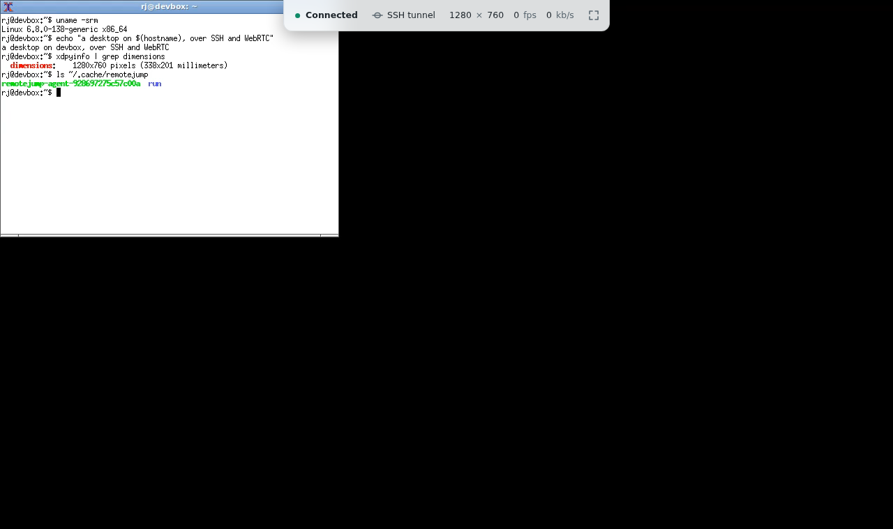

# Robin

Named for Nico Robin, who sprouts eyes and hands on any surface she can
see. This one sprouts yours on any Linux box you can ssh to.

`robin gui <host>` opens a Linux desktop from `<host>` in your browser.
The only thing the host needs beforehand is SSH access you already have: the
CLI connects with your own `ssh`, copies a small static agent over, starts a
headless X session as you, and streams it back over WebRTC. No signaling
server, no ports opened for auth, no root.



Media goes straight over UDP when the network allows it. When it does not
(UDP blocked, or a host you only reach through `ProxyJump`), it rides the SSH
connection instead, and if UDP disappears mid-session the browser moves onto
that path by itself in about three seconds.

## Install

From a checkout, with Go 1.25 or newer:

```sh
make
```

That fetches a pinned zig toolchain and builds openh264 and libopus the first
time (about half a minute, cached under `.cache/`), builds static agents for
linux/amd64 and linux/arm64, and embeds both in `bin/robin`. `make dist`
cross-builds the CLI for macOS, Linux and Windows on amd64 and arm64 into
`dist/`. The CLI itself is pure Go; only the agents need the C toolchain, and
the build downloads it, so there is nothing to install by hand on Linux or
macOS.

## Usage

```sh
robin gui alice@build-box
robin gui build-box -- -p 2222 -i ~/.ssh/other_key   # anything after -- goes to ssh
robin gui --max-size 2560x1440 --fps 60 workstation
robin gui --no-browser lab-node                     # print the URL instead of opening it
robin gui --attach auto workstation                 # the desktop you are logged in to there
robin gui --attach wayland workstation              # your GNOME or Plasma session on Wayland
```

Your `~/.ssh/config`, agent, `ProxyJump`, `ProxyCommand`, certificates and
password or 2FA prompts all work as they do for plain `ssh`, because it is
plain `ssh`: one ControlMaster connection carries the probe, the agent upload,
the agent itself and the tunnel. Windows' OpenSSH has no ControlMaster, so
there each of them opens a connection of its own (see
[What the client needs](#what-the-client-needs)). The browser tab can be
reloaded; the remote session survives until you press Ctrl+C in the
terminal.

With `--attach`, nothing new is started: the agent streams a desktop that is
already running on the host, usually the one you are logged in to at the
machine. `wayland` takes your Wayland session through the desktop's screen
sharing portal, which asks first (see
[Attaching to a Wayland desktop](#attaching-to-a-wayland-desktop)). The rest
of this section is about X11. `auto` picks the Wayland session when that is
the active one, else the display of your active X11 session, or the one X
server you own when the session does not name one (GDM never does), and `:1`
names a display outright. The cookie comes from wherever startx, LightDM, GDM, mutter
or SDDM left it; failing that, the agent gets in the way an
`xhost +si:localuser:$USER` grant allows.

That desktop stays shared: whoever sits at the machine sees the pointer move.
It keeps its own resolution, too. Your browser window scales the picture
instead of resizing the screen, and a desktop larger than `--max-size` (a 4K
monitor) is scaled down to fit, with the pointer mapped back onto the
full-size screen.

A desktop of several monitors shows one of them at a time, starting with the
primary one; `--monitor` picks another by name (`--monitor DP-2`) or by its
number in `xrandr --listmonitors` order (`--monitor 2`), and `--monitor all`
shows every monitor as one picture. While connected, the status tab at the
top of the page lists the monitors, with their sizes, and switches between
them. Three monitors side by side in one picture would be shrunk until text
is unreadable, which is why one monitor is the default. Ending the session closes the agent's X
connection and nothing else; autorepeat and the keys it bound for characters
missing from the keymap go back to how they were, and clipboard text pasted
from the browser is handed to the desktop's clipboard manager if one runs.
The desktop's sound comes along. A browser only starts a video by itself
while it is muted, so the page opens silent and the status tab shows a
speaker: click it to hear the session, and again after a reload. When the
host cannot provide sound the session runs without it, and the CLI says why.

| Flag | Default | |
|---|---|---|
| `--transport` | `auto` | `direct` for UDP only, `tunnel` to force the SSH path |
| `--max-size` | `1920x1080` | largest remote resolution; the display follows your window up to this. 1280x720 on hosts with two cores or fewer |
| `--fps` | `30` | frame rate cap (20 on small hosts) |
| `--hidpi` | off | size the remote display in the browser's device pixels: sharp text on Retina screens, about four times the pixels to encode. Raise `--max-size` to go fully native |
| `--max-kbps` | `10000` | video bitrate ceiling; congestion control works below it |
| `--encoder` | `auto` | `auto` encodes on the host's GPU where it pays and in software elsewhere; `software`, `vaapi` or `nvenc` insist on one; see [Hardware encoding](#hardware-encoding) |
| `--session` | lightest found | command to run in the display, e.g. `startxfce4` |
| `--attach` | | stream a desktop already running on the host: `auto`, `wayland` for your Wayland session, or an X display such as `:1` |
| `--monitor` | `primary` | the monitor of an attached X11 desktop to show first: a name such as `DP-2`, its number, or `all`; the page switches between them. Wayland shows the monitor picked in its sharing dialog |
| `--audio` | `true` | stream the desktop's sound; `--audio=false` leaves it out |
| `--stun` | Google's public server | STUN servers for NAT traversal, comma-separated, or `none` |
| `--no-browser` | | print the page URL on stdout instead of opening a browser |
| `--listen` | `127.0.0.1:0` | address for the local page; loopback only |
| `--ssh` | `ssh` | the ssh client to drive |
| `--ssh-mux` | `true`, `false` on Windows | carry everything over one ControlMaster connection; `--ssh-mux=false` gives the probe, the upload, the agent and the tunnel an ssh connection each, as on Windows |
| `-v` | | log the CLI and the agent to stderr |

## What the host needs

Linux on x86_64 or arm64, an SSH server you can log in to, and for the
headless session: `Xvfb` plus something to run in it, either a desktop
(`xfce4-session`) or a window manager (`openbox`, `fluxbox`, `icewm`, `twm`)
with a terminal (`xterm`). If anything is missing the CLI says what, with the
install line for that distro, for example:

```
sudo apt install xvfb openbox xterm
```

Attaching to a running desktop needs none of that, only the desktop, plus
GStreamer's tools for a Wayland one.

For sound in a spawned session the host also needs `pulseaudio`. The agent starts
a private one with a null sink as its only output and its socket in the
agent's run directory, so it touches neither the sound hardware nor a sound
server you already run, and it stops with the session. Attached to a running
desktop, the agent records that desktop's own sound server instead,
PulseAudio or PipeWire alike, since PipeWire speaks the same protocol through
`pipewire-pulse`.

No GPU or monitor is needed; the session renders in software, and a light
window manager keeps that cheap. Software H.264 at 1080p30 costs one to two
cores, which is why small hosts get a lower default size and frame rate.

The agent goes to `~/.cache/robin` (or `$XDG_RUNTIME_DIR/robin`, or
`/tmp/robin-$UID` when the home directory is mounted `noexec`), checked
by hash and reused across sessions. It runs as you, starts its own display on
a free number, and when the SSH channel closes it kills everything it started
and removes its files.

## Attaching to a Wayland desktop

`--attach wayland` streams the GNOME or KDE Plasma session you are logged in
to on the host instead of starting a new one. It goes through
xdg-desktop-portal, the same screen sharing a video call app uses, which
means the desktop asks before anyone sees it. `--attach auto` picks it when
the session logind reports as active is a Wayland one.

The first time, a dialog comes up on the host's own screen and someone sitting
there has to answer it. On GNOME, switch on Allow Remote Interaction before
pressing Share, or the session is view only; the CLI says so if that happens,
and also says, while it waits, what to approve and for how long (two minutes).
KDE Plasma asks once for both the picture and the input, and Approve grants
them together.
Approval gets the agent a restore token from the portal. The agent keeps it
next to itself on the host, in `wayland-restore-token`, readable only by you,
and every later session starts with no dialog at all. Delete the file to be
asked again. A view-only approval is never remembered, so the next run asks
once more.

Ending the session gives the screen back as it was. Stopping the share from
the host's own indicator ends the remote session too. Sound comes along as
it does on X11, recorded from PipeWire's PulseAudio server, which current
GNOME and Plasma desktops run.

The agent reads the screen through GStreamer, so the host needs
`gst-launch-1.0` and the PipeWire, base and good plugin sets. A desktop
install usually has everything but the tools package; the CLI checks and
prints the line for your distribution, for example:

```
sudo apt install gstreamer1.0-tools gstreamer1.0-pipewire gstreamer1.0-plugins-base gstreamer1.0-plugins-good
```

Streaming a fully animated 1280x720 screen at 30 fps costs `gst-launch-1.0`
about 6% of one core, on top of the encoder. An idle screen costs next to
nothing: repeated frames are not encoded.

## Hardware encoding

```sh
robin gui --max-size 3840x2160 build-box   # auto: the GPU, if build-box has one
robin gui --encoder vaapi build-box        # Intel or AMD through VA-API, or fail
robin gui --encoder nvenc gpu-box          # NVIDIA, or fail
robin gui --encoder software build-box     # never the GPU
```

By default the CLI picks the encoder from the probe. It takes the GPU when
the host can drive it and the GPU pays for the latency it adds: on hosts
with four cores or fewer, and for sessions above 1920x1080 when ffmpeg can
drive the GPU. VA-API comes before NVENC. Everywhere else it stays in
software. If the GPU it picked fails on the host, the session carries on in
software, and `-v` shows which encoder was picked, why, and why it fell back.
An encoder named with `--encoder` is used or the session fails.

The agent is a static binary and cannot load the host's GPU libraries, so
for these it pipes frames through a tool the host already has: ffmpeg, or
GStreamer's `gst-launch-1.0`. VA-API needs a render node in `/dev/dri` you
can open (usually that means being in the `render` group) and either ffmpeg
built with `h264_vaapi` or `gst-launch-1.0` with GStreamer's va or vaapi
plugin and gst-plugins-good. NVENC needs the NVIDIA driver loaded, and
ffmpeg with `h264_nvenc` or GStreamer's nvcodec plugin. On Debian and
Ubuntu, `sudo apt install ffmpeg` brings both encoders. The CLI checks all
of this against the probe before it deploys anything and says what is
missing; the agent then tries each route the host offers on a test frame,
ffmpeg first, and if none works the error lists why each one failed.

That is why `auto` leaves a 1080p session on a bigger host in software: on
a reasonably fast CPU the GPU saves little. On an i7-13800H with its iGPU,
a session scrolling a terminal cost about a fifth of a core at 1440x900 and
about one core at 3840x2160 with either encoder: copying each frame out to
the tool eats most of what the GPU saves. It pays where openh264 is the
bottleneck, on slow CPUs and on busy 4K content (28 ms of CPU per frame for
openh264 against 12 ms through ffmpeg). GStreamer's route spends 31 to 34
ms on a 2160p frame, a whole frame at 30 fps, so `auto` uses it on small
hosts only. What the GPU costs:

- A keyframe the browser asks for takes about 40 ms instead of 5, because a
  running tool cannot be asked for one and is restarted instead.
- Each frame spends 5 ms in the encoder at 1080p and about 20 ms at 2160p
  through ffmpeg, against 1 to 3 and 5 to 10 ms for openh264; GStreamer's
  vaapi plugin takes 31 to 34 ms at 2160p, a whole frame at 30 fps.
- Congestion control is followed by skipping frames, and the tool is
  restarted at the new bitrate when the target has moved twofold, at most
  every two seconds.
- The first GStreamer run on a host builds its plugin registry, which can
  take a few seconds.
- NVENC follows NVIDIA's documented options but has not been run on NVIDIA
  hardware yet.

The measurements and the reasons behind the design are in the
[ADR](docs/adr/0001-architecture.md#hardware-h264-through-a-host-tool-picked-where-it-pays).

## What the client needs

OpenSSH and a browser that decodes H.264 in WebRTC, on one of:

- **macOS or Linux**, where one ControlMaster connection carries the whole
  session.
- **Windows 10 or 11**, with the OpenSSH client Windows ships
  (`ssh.exe` on `PATH`). It has no ControlMaster, so the CLI runs the probe,
  the upload, the agent and the tunnel as an ssh each, and each logs in on
  its own: with a key or `ssh-agent` that goes unnoticed, while a password or
  2FA prompt comes three times a session, five when the agent is uploaded. The tunnel listens on a loopback TCP
  port, as Windows' OpenSSH forwards no unix sockets. `make dist` builds
  `robin-windows-amd64.exe` and `robin-windows-arm64.exe`; the page opens in
  the default browser.
- **Android**, in [Termux](https://termux.dev) with its `openssh` package:
  `dist/robin-linux-arm64` runs there as it is, and the page opens in
  Android's browser through `termux-open-url` (from `termux-tools`). The page
  takes touch: a tap clicks, a long press right clicks, one finger drags,
  two fingers scroll, and pinching zooms and pans the picture on the phone
  without resizing the desktop. The keyboard button in the status tab raises
  the soft keyboard.

iOS and iPadOS cannot be clients. The CLI has to run beside the browser,
because the page is served on loopback only, and nothing on iOS lets a user
run a program that drives `ssh` and listens on loopback for the browser.

Input methods work in any of these browsers: the keyboard's focus rests in
a hidden text box, so text an input method composes (CJK, or an accent
built from a dead key) goes to the remote desktop once it is committed, and
shows under the status tab while it is being composed. What the end-to-end
tests prove for each browser:

- **Chrome** runs every scenario: picture, input, latency, sound,
  clipboard, resize, transports, attach and Wayland. Edge shares its engine.
- **Firefox** passes every check of the direct scenario, latency and sound
  included, given Cisco's OpenH264 plugin. Firefox downloads it by itself
  on first use (it shows under Add-ons and themes, Plugins); a Firefox that
  cannot fetch it offers no H.264, and the page stays black.
- **Safari** on macOS shows the picture and takes keyboard and pointer
  input, checked by hand from an Apple silicon Mac on 2026-10-24. In the
  automated tests it is stood in for by Playwright's WebKit on Linux, which
  shares Safari's WebRTC stack: it negotiates Constrained Baseline H.264,
  decodes it, plays the sound, carries keyboard, clipboard and resize, and
  tears down cleanly. That build renders no remote WebRTC video at all (a VP8
  loopback in a blank page stays black too), so the e2e suite cannot check
  Safari's picture and the hand check is the only one.

## How it works

1. `ssh -M` opens the one connection everything else uses. Without
   ControlMaster, on Windows, each step below opens its own.
2. A POSIX shell probe reports the distro, architecture, live sessions, GPU,
   which spawn-mode tools exist, and a directory where the agent can run.
3. The agent for that architecture is uploaded over SFTP, verified by
   SHA-256 on the host and renamed into place.
4. The agent starts on an exec channel. Its stdin and stdout carry signaling
   as JSON lines, with a heartbeat both ways so a dead connection tears the
   session down instead of leaving a display running.
5. It starts Xvfb and a session, or attaches to the X display already
   running, and captures with MIT-SHM and DAMAGE. A Wayland desktop is
   reached through xdg-desktop-portal instead, its frames read from PipeWire
   by `gst-launch-1.0`. Frames are encoded with openh264, or with the GPU
   through the host's ffmpeg or GStreamer where the probe finds that it
   pays, and sent over a Pion peer connection. Sound comes from the monitor of a
   PulseAudio or PipeWire sink, read over the PulseAudio protocol in Go, and
   goes out as Opus from libopus. Keyboard, pointer, clipboard and resize
   come back over a data channel and go in through XTest and RandR, or the
   portal on Wayland. Payloads too big for that channel have a transfer
   layer of their own, a data channel each and a SHA-256 checked at the far
   end, which no feature uses yet.
6. The CLI serves the page on loopback and relays offer, answer and
   candidates between it and the agent, adding one passive TCP candidate that
   leads into an SSH forward to the agent.

The decisions behind each of these, and what measurement changed along the
way, are in [docs/adr/0001-architecture.md](docs/adr/0001-architecture.md).

## Security

The agent's DTLS fingerprint reaches the browser only through SSH and the
local page, and the CLI pins it for the session, so nobody who can merely
reach the UDP or TCP path can stand in for the agent. The page and its
websocket listen on 127.0.0.1 and require a random 256-bit token from the URL
fragment, an exact `Origin` and `Host`, and allow one browser at a time. On
the host, the agent's ICE-TCP listener binds loopback and only accepts ICE
connections carrying the session's credentials; the X display is protected by
a fresh cookie in a 0600 file; the session's sound server listens only on a
socket inside the run directory; the agent and its run directory are 0700.
Input from the page is limited to what a keyboard, a pointer and a clipboard
can do in that session. Text from an input method or a soft keyboard types
what keys could type: through spare keycodes on X11 and, on Wayland, as
keysyms for ASCII and as a paste for the rest. That paste puts the text on
the desktop's clipboard for about a second, where any program on the desktop
can read it and a clipboard manager there keeps it in its history, before
the clipboard gets back the text it held. The agent also listens for bulk transfers from the
page, but takes only kinds a feature has registered, and no feature has yet,
so it refuses every one.

One exposure is on the client side: to open your browser the CLI hands the
page URL, token included, to `open`, `xdg-open`, `rundll32` on Windows or
`termux-open-url` on Android, so for that moment another user logged in to
the same client machine could read it from the process list. On a shared
client, use `--no-browser` and open the printed URL yourself. Without
ControlMaster (Windows, or `--ssh-mux=false`) the ICE-TCP tunnel's client end
is a loopback TCP port rather than a socket in a private directory, so
another user of the client machine can connect to it; what answers is the
agent's ICE-TCP listener, which takes nothing without the session's ICE
credentials, and the DTLS fingerprint is pinned as before.

## Testing

```sh
make test     # unit and integration tests; the encoders against real openh264 and libopus on linux/amd64
make test-js  # the page's pure modules under node --test (make test runs them too where node is installed)
make test-x   # capture, input, display, sound server and agent session tests against Xvfb and pulseaudio, in podman
make test-wayland  # Wayland attach against headless GNOME 46, GNOME 49 and KDE Plasma 6.7, in podman
make e2e      # the whole thing: podman host, Playwright and Chrome client
make check    # all four
make cover    # all four again with coverage, merged, checked against coverage-baseline.txt
```

`make cover` runs every suite with coverage and merges it in
`.cache/cover/`: the unit tests (the cgo-tagged encoder packages included),
the test-x and test-wayland binaries, and e2e with the CLI and the agent
built with `-cover`. Every Go suite instruments the whole module, so a
session test in `internal/agent` counts for `x11` and `peer` too. It prints
statement coverage per file and per package (`summary.txt`, with
`merged.out` and `cover.html` beside it), and line coverage per script of
the page (`page.txt`), from Chrome in e2e and from `make test-js`. It fails
when a package falls more than 0.5 points below its line in
`coverage-baseline.txt`; `make cover-baseline` rewrites that file from the
last run, which only main does. `make cover-unit cover-report` gives a quick
look without containers. A suite that fails still hands in what it
covered, and `make cover` fails after the report.

`make test-wayland` boots three desktops, each in its own container with a
virtual monitor, PipeWire and the desktop's own portal: mutter 46 on Ubuntu
24.04, mutter 49 on Fedora 43, and kwin_wayland 6.7 with
xdg-desktop-portal-kde on Fedora 43 (`WLTEST_DESKTOPS` picks fewer). Nobody
sits at those screens, so the harness answers the consent dialog itself:
through mutter's own remote desktop interface on GNOME, and by pressing
Approve through the accessibility bus on KDE, paths only the tests use. It
checks that the first session asks and the second restores without asking,
that frames arrive and change, pointer, keys and held-key repeat, text
typed as keysyms or pasted with the clipboard put back after, the
clipboard both ways, view-only grants (GNOME only; KDE has none), and that
no `gst-launch-1.0` or portal session outlives the agent, whether it closes
or is killed. A tone played into each session's PipeWire must come out of
the agent's capture through `pipewire-pulse`. KWin screencasts only when it
composites with OpenGL, so the KDE container borrows the host's GPU render
node, and is skipped, with a line saying so, on a machine without one.

`make e2e` runs four scenarios against a fresh host container each: direct
UDP, UDP blocked on the host from the start, UDP blocked mid-session, and
`--attach auto` against a two-monitor desktop the test user already has
running, where the page has to start on the primary monitor and switch to
the other and to both. A fifth, `nomux`, is the blocked one with
`--ssh-mux=false`, the Windows way, and checks no ControlMaster ran and no ssh
outlives the CLI. Each
asserts that decoded frames are not black and change after typing, that
keystrokes after a 20 s pause reach the screen within 400 ms, that typed
text runs in the remote shell, as does text an input method commits in
Chrome, pointer position, clipboard both ways, resize,
that sound played on the host is heard once the speaker is on, which
transport ICE picked, and that nothing survives the CLI; for the attached
desktop that means a resize leaves its screen alone and it outlives the session
with the same processes, autorepeat and keymaps. A fifth scenario, `wayland`,
runs the same CLI and browser against the headless GNOME session of
`make test-wayland` over sshd: `--attach auto` picks it, the CLI waits while
the harness answers the consent dialog, and Chrome then has to show the
monitor with the remote pointer drawn in, land motion, clicks and typed text
in a probe window, pass the clipboard both ways through the portal, play the
session's PipeWire sound, and meet the same 400 ms latency bound. SIGINT
must leave no agent, `gst-launch-1.0` or portal session and a 0600 restore
token, and a second run must start without asking. The `firefox` and
`webkit` scenarios repeat the direct one in Playwright's own Firefox and
WebKit builds; see the client section above for what each of them proves.
The `touch` scenario runs Chrome as a touch screen: taps and a pinch-zoomed
tap must put the X pointer within 2 px of the pixel under the finger, two
fingers must scroll the xterm back, and the keyboard button's soft keyboard
must type a command that runs.
See [e2e/README.md](e2e/README.md). Rootless containers cannot shape bandwidth,
so congestion control is tested separately over a shaped virtual link
(`go test ./internal/agent/peer -run Congestion`).

Bulk transfers run between two Pion peers in one process, both ways, along
with the ones that must fail: oversized, corrupt, truncated, refused and
cancelled, including a cancel while the sender waits for its queue to drain
(`go test ./internal/agent/peer -run Bulk`). One goes through the shaped
link while video streams, to measure how the two share it. `go test
./internal/web` runs the page's DOM-free modules under `node --test`, from
`internal/web/static/test`, and, with the browser smoke test's dependencies
installed, sends bulk transfers both ways between Chrome and the agent's own
peer, which is where the page's SHA-256 and flow control meet the real
thing. It also drives an input method in desktop Chrome and taps, a long
press, a two-finger scroll, a pinch and the soft keyboard in Chrome as a
phone, and checks what the page sends for each.

The hardware encoders are tested against stand-in tools everywhere, and
against the real GPU wherever `make test` runs on a host that has one along
with a tool to drive it (a GPU with neither ffmpeg nor a GStreamer encoder
plugin skips): every route the host offers must produce a Baseline IDR
first, P slices after, an IDR on request and the target bitrate on noise,
and ffmpeg, where it is installed, must decode the result. Set
`ROBIN_HWENC_REQUIRE=vaapi` (or `nvenc`) to make a missing route fail the run
instead of skipping it, and `ROBIN_HWENC_COMPARE=1` with the openh264 build tag
to print the comparison the ADR quotes.

## Known limits

- `--attach auto` never picks an X display inside a Wayland session, because
  the X server you own there is Xwayland, whose screen holds none of the
  desktop. It takes the Wayland session itself when the probe finds its
  socket and session bus.
- Attaching to Wayland needs someone at the host's screen to approve it the
  first time. It works through the portal's remote desktop interface, which
  GNOME and KDE Plasma have; wlroots compositors such as Sway do not.
- On Wayland, a key only types if the host's keyboard layout has its
  character: the compositor drops any other keysym, and there is no spare
  keycode to bind one to as on X11. Text from an input method or a soft
  keyboard goes in as keysyms when it is all ASCII and as a paste with
  Ctrl+V otherwise, so it lands wherever Ctrl+V pastes: not in a terminal,
  which pastes with Ctrl+Shift+V, and only as text the clipboard held is put
  back a second later; an image there is lost. A host layout without Latin
  letters drops the ASCII keysyms too.
- GNOME drops the first key event of each remote session, and now and then
  the first pointer event. The agent spends both on input that does
  nothing, so you should not notice, but it is why mutter logs `No keycode
  found for keyval ffffff` when a session starts.
- An attached Wayland desktop keeps its own size and shows one monitor. A
  screen larger than `--max-size` is scaled down, and a scaled (HiDPI)
  screen streams at its logical size, so text is softer than on the host.
- On Wayland the pointer is drawn into the video, so it moves at the
  video's pace, a round trip behind your hand; the browser hides its own
  pointer over the picture.
- Held keys on Wayland repeat at the host's own rate, and the browser's
  repeats are not sent. A held key during a network stall keeps repeating
  on the host until the key-up gets through.
- The Wayland tests run against GNOME 46, GNOME 49 and KDE Plasma 6.7.
  Other versions and distributions are untested.
- KDE Plasma shares its screen only while KWin composites with OpenGL. With
  KWin's QPainter fallback, used where it finds no GPU to render with, the
  portal refuses to start and the session ends with "Start failed".
- An attached X11 desktop shows one monitor at a time in one browser tab;
  there is no window per monitor. With `all`, every monitor arrives as one
  picture, gaps included, scaled to fit `--max-size`, so small text gets
  hard to read. Monitors come from RandR 1.5; an X server older than that
  shows the whole desktop.
- Attached to X11, autorepeat is off for the whole display, keys held at the
  machine itself included, until the session ends.
- Text pasted from the browser into an attached desktop outlives the session
  only if that desktop runs a clipboard manager.
- Sound in a spawned session needs `pulseaudio` on the host. Current Fedora
  and Ubuntu desktops ship PipeWire without it, and their spawned sessions
  are silent.
- The page starts muted, because browsers autoplay only silent video: one
  click on the speaker, again after each reload.
- Sound goes one way; there is no microphone.
- In-band FEC protects speech only. Opus sends speech in hybrid mode, whose
  SILK layer repeats the previous frame at low rate; music stays in CELT,
  which has no such redundancy, so a lost music packet is concealed by the
  browser instead.
- Attached, the sound is the monitor of whatever output was the default when
  the session started, and the host's own speakers keep playing it.
- Clipboard is plain text up to 255 KiB in each direction.
- Bulk transfers, the layer file and rich clipboard transfers are to use,
  are not paced against the video. On a 3 Mbit/s link a 2 MiB transfer
  takes about 9 s, the picture drops to about 1 Mbit/s meanwhile and
  needs another 7 to 9 s to get its rate back. On the agent, a transfer
  whose receiver stops reading holds up keyboard and pointer input with
  it, since every data channel shares one SCTP receive window.
- Keys map by character, so text arrives right whatever the client layout.
  An input method's text arrives when it is committed: the composition shows
  in the page, not in the remote program, which gets no preedit of its own.
  On X11, committed text with more than 16 characters the keymap lacks
  types at about 16 such characters every 50 ms, while the keycodes it
  borrows settle.
- Touch maps onto one pointer: one finger is the mouse, so panning a zoomed
  picture takes two fingers, and there is no momentum or double tap. A soft
  keyboard has no Ctrl, Alt, Esc or arrow keys to send.
- The Android client has been checked in Chrome's phone emulation only, and
  the Windows client in cross-builds, `go vet` and the `nomux` scenario's
  forced mode on Linux. Neither has run on the real thing.
- Without ControlMaster a dropped network ends the session when the agent's
  connection goes quiet for its idle timeout, not at once, and every
  `LocalForward` in your ssh config for that host comes up with the
  tunnel's own ssh; one that fails takes the tunnel with it.
- The status tab reads 0 fps on an idle screen. Nothing is sent when nothing
  changes; that is not a stall.
- Through the SSH tunnel video is TCP inside TCP, so a lossy link shows
  head-of-line stalls that direct UDP would not.
- Safari's picture is checked by hand only: the WebKit the tests drive on
  Linux renders no remote WebRTC video (see What the client needs).
- Firefox shows no picture until it has fetched its OpenH264 plugin, which
  needs a network connection the first time.
- The macOS client has run on an Apple silicon Mac, in Chrome and in
  Safari, attached to an X11 desktop over Tailscale. Building the agents
  from a Mac is untried.
- One browser per session; a second tab is refused until the first closes.
- `make cover` counts only runs that end normally. A test binary that
  times out or panics, and a CLI or agent that is killed, hand in nothing,
  so a failing e2e scenario lowers the numbers, and without a GPU render
  node the KDE run of test-wayland adds none. The page is measured in
  Chrome and Node only; the Firefox and WebKit scenarios count for the Go
  side.
- Hardware encoding answers a keyframe request about 35 ms later than
  software and adds a few milliseconds to every frame, which is the price on
  the hosts and sizes where `auto` picks it. The NVENC route is untested on
  real hardware; see [Hardware encoding](#hardware-encoding).
