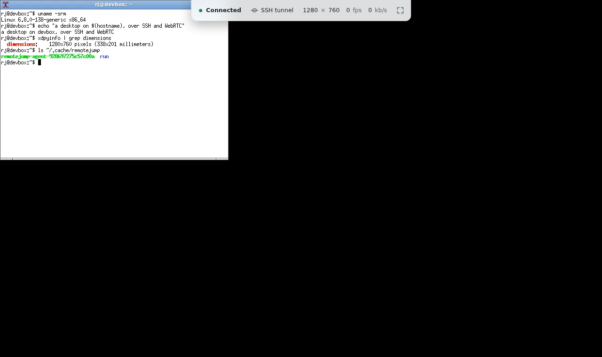

`robin gui <host>` opens that host's Linux desktop in your browser. It connects with your own `ssh`, copies a small agent over and runs it as the user you log in as, so the host needs no root and nothing of Robin's installed, and you open no port in its firewall either.

The picture goes over UDP when the network lets it through, otherwise over your SSH connection.

## Who it is for

Anyone who already has a shell on a Linux machine and wants its screen: a headless build box or lab node, or the workstation you are logged in to at the office.

Robin drives plain `ssh`. Your `~/.ssh/config`, keys, agent, `ProxyJump`, certificates and 2FA prompts all apply, so if `ssh build-box` gives you a prompt, `robin gui build-box` can reach the host.

You run robin on macOS, Linux, Windows 10 or 11, or Android in Termux, with OpenSSH and a browser that decodes H.264, as [Browsers and clients](/browsers) covers.

## Spawn or attach

**Spawn** is the default: the agent starts a fresh desktop for you on the host, sized to your browser window, and throws it away when the session ends. If the host lacks `Xvfb` or a desktop to run in it, robin names what is missing and, on common distributions, the line that installs it; see [Getting started](/getting-started).

**Attach** shows a desktop that is already running, on X11 or Wayland, usually the one you are logged in to at the machine. Nothing new starts and the desktop is left as you found it; [Attaching to a desktop](/attach) has the rest. Keeping the room's screen dark and its speakers quiet while you work is what [Private sessions](/private-session) are for.

## What a session carries

Besides the picture and your keyboard and pointer:

- [Kept sessions](/sessions): a desktop robin started outlives a dropped connection, and **Disconnect, keep desktop** leaves it there for the next `robin gui`.
- [Sound, microphone and camera](/sound): the desktop's sound in your browser, and your microphone and camera on the host when you offer them.
- [Files and the clipboard](/files-and-clipboard): upload files and fetch them from the host, and copy text, HTML and images both ways.
- [Keys and macros](/macros): send the keys your browser keeps for itself, and your own key sequences.
- [Sharing a desktop](/sharing): invite another account on the host to watch, and hand it control.

## What Robin is not

Robin is not a VDI platform. It has no broker and no desktop pool, nor an account system of its own; who can use a desktop comes down to who can ssh to the host.

iOS and iPadOS cannot be clients, because the page is served on your own machine's loopback: robin has to run beside the browser, and iOS gives you nothing that runs it.
